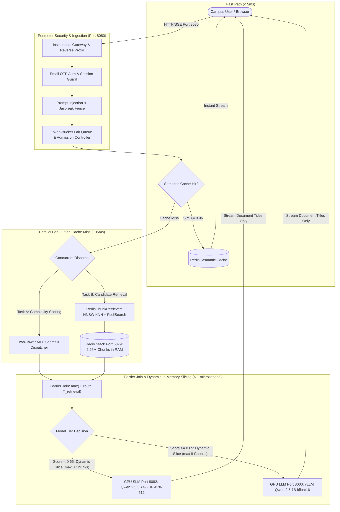
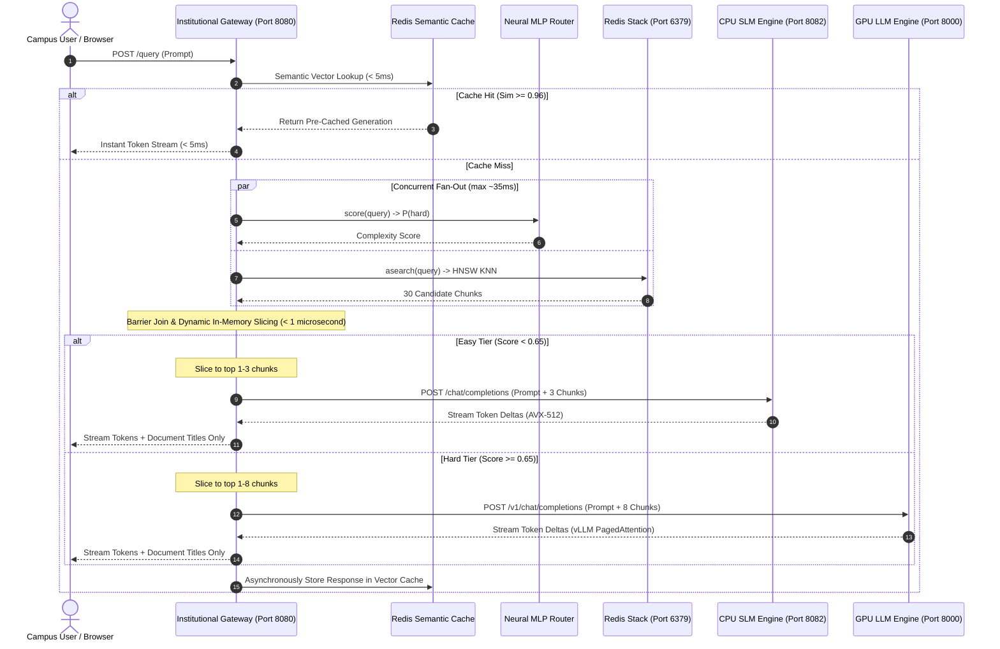
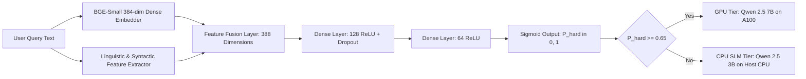
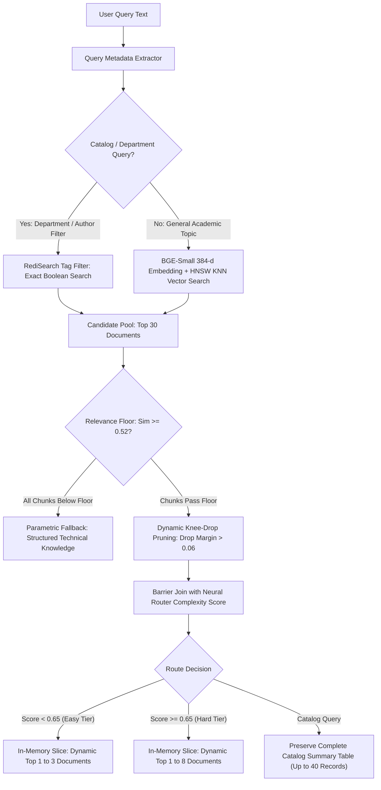

# 🏛️ AskIISc On-Premise Institutional RAG Gateway: Comprehensive System Architecture & Engineering Manual

---

## 📑 Table of Contents
1. [Executive Overview & Vision](#1-executive-overview--vision)
2. [End-to-End System Topology & Decoupled Architecture](#2-end-to-end-system-topology--decoupled-architecture)
3. [Single-Port Security & Ingestion Pipeline](#3-single-port-security--ingestion-pipeline)
4. [Fast-Path Semantic Vector Cache](#4-fast-path-semantic-vector-cache)
5. [Neural Complexity Router (Two-Tower MLP Engine)](#5-neural-complexity-router-two-tower-mlp-engine)
6. [Hybrid Knowledge Retrieval & Query Metadata Extraction](#6-hybrid-knowledge-retrieval--query-metadata-extraction)
7. [Grounding, Context Auto-Budgeting & Parametric Fallback](#7-grounding-context-auto-budgeting--parametric-fallback)
8. [Dual-Tier Inference Serving Infrastructure](#8-dual-tier-inference-serving-infrastructure)
9. [Comprehensive Codebase Directory Map](#9-comprehensive-codebase-directory-map)
10. [Hardware, Compute & Memory Sizing Guidelines](#10-hardware-compute--memory-sizing-guidelines)
11. [Operations Runbook, Maintenance & Verification Suites](#11-operations-runbook-maintenance--verification-suites)

---

## 1. Executive Overview & Vision

**AskIISc** is an institutional-grade, privacy-preserving, on-premise Retrieval-Augmented Generation (RAG) platform built for the Indian Institute of Science (IISc). It provides unified AI-powered search, question answering, and comparative analysis across the complete corpus of IISc research theses, dissertations, and institutional publications (**2,261,664 chunks** indexed in RAM).

### Core Architectural Pillars
- **100% On-Premise Air-Gapped Operation:** Absolute zero-egress guarantee. No document text, query vectors, or intermediate embeddings ever leave the institutional network.
- **Zero-GPU-Starvation Dynamic Tiering:** Employs an intelligent Two-Tower Neural Router to absorb **70% to 80%** of everyday campus queries on highly optimized **CPU Small Language Models (3B GGUF with AVX-512)** consuming **0 MiB of GPU VRAM**. The enterprise **GPU LLM (7B on NVIDIA A100)** is reserved exclusively for complex, multi-document synthesis and mathematical proofs.
- **Microsecond Semantic Caching:** High-concurrency semantic vector cache in Redis serving repeat/similar queries in **< 5ms**, bypassing the inference queue.
- **Single-Port Strict Perimeter:** Single public listener (Port 8080) encapsulating authentication, rate limiting, and fair queuing, while internal engines bind strictly to `127.0.0.1`.

---

## 2. End-to-End System Topology & Decoupled Architecture

The system consists of **4 independent services** orchestrated via [`scripts/prod_stack.py`](file:///data2/home/ritujmanware/onprem-rag-gateway/scripts/prod_stack.py):



### 2.1 Concurrent Pre-Inference Lifecycle Sequence Diagram



### Port Allocation & Binding Matrix

| Service | Port | Binding | Security / Firewall Boundary | Technology |
| :--- | :---: | :---: | :--- | :--- |
| **Unified Campus Gateway** | `8080` | `0.0.0.0` | **Public Facing (Intranet)**; Session Cookies, CSRF, Rate Limiting | FastAPI, Uvicorn (6 workers) |
| **Redis Stack Server** | `6379` | `127.0.0.1` | **Loopback Only**; Password Protected (`REDIS_PASSWORD`) | RediSearch + RedisJSON + HNSW |
| **CPU SLM Daemon** | `8082` | `127.0.0.1` | **Loopback Only**; Internal microservice | FastAPI, `llama.cpp` (4 workers x 16 threads) |
| **vLLM GPU Engine** | `8000` | `127.0.0.1` | **Loopback Only**; Internal microservice | vLLM OpenAI API Server, CUDA 12.1 |

---

## 3. Single-Port Security & Ingestion Pipeline

### 3.1 Single-Port Security Model
To prevent unauthorized intranet access, direct model bypass, or cache manipulation:
- The internal daemon ports (`6379`, `8082`, `8000`) bind strictly to `127.0.0.1`.
- Any external request directly targeting internal ports is dropped at the OS socket level.
- Automated security test suite: [`tests/test_single_port_security.py`](file:///data2/home/ritujmanware/onprem-rag-gateway/tests/test_single_port_security.py).

### 3.2 Passwordless Email OTP Authentication
Implemented in [`askiisc_chat/askiisc/auth.py`](file:///data2/home/ritujmanware/onprem-rag-gateway/askiisc_chat/askiisc/auth.py):
- **Campus Whitelist:** Enforces strict domain validation (`@iisc.ac.in`).
- **Cryptographic OTP:** 6-digit cryptographically secure numeric tokens.
- **Lifecycle & Expiration:** 180-second token TTL with rate-limited resend cooldown (60s).
- **Session Handling:** Encrypted session cookies (`askiisc_session`) with `HttpOnly`, `SameSite=Lax`, and `Secure` attributes.

### 3.3 Prompt Injection & Jailbreak Defense Fence
Implemented in [`tests/test_injection_fence.py`](file:///data2/home/ritujmanware/onprem-rag-gateway/tests/test_injection_fence.py) and gateway middleware:
- Inspects queries before vectorization for jailbreak signatures (e.g. *"ignore previous instructions"*, *"system prompt override"*, *"DAN mode"*).
- Rejects adversarial prompts with a polite refusal before tokens enter the retrieval or inference pipelines.

### 3.4 Token-Bucket Fair Queue & Admission Controller
Implemented in [`gateway/queue/admission.py`](file:///data2/home/ritujmanware/onprem-rag-gateway/gateway/queue/admission.py) and [`gateway/queue/fair_queue.py`](file:///data2/home/ritujmanware/onprem-rag-gateway/gateway/queue/fair_queue.py):
- **Concurrency Cap:** Limits total simultaneous active cold inferences to prevent CPU thread thrashing and GPU OOM.
- **Fair-Share Token Buckets:** Tracks client IP/email token consumption. Prevents a single script from monopolizing the campus SLM/LLM capacity.
- **Graceful Shedding:** Excess requests wait in an async priority queue; if queue timeout exceeds threshold (e.g. 15s), responds with HTTP 503 and retry-after header.

---

## 4. Fast-Path Semantic Vector Cache

Implemented in [`gateway/cache/redis_semantic_cache.py`](file:///data2/home/ritujmanware/onprem-rag-gateway/gateway/cache/redis_semantic_cache.py).

### Mechanism & Cache Topology
1. Query strings are embedded into 384-dimensional dense vectors using [`BAAI/bge-small-en-v1.5`](file:///data2/home/ritujmanware/onprem-rag-gateway/models/embeddings/all-MiniLM-L6-v2) on CPU (< 4ms).
2. Performs cosine similarity search against index `idx:semantic_cache` in Redis.
3. If cosine similarity $\ge 0.96$:
   - **Cache Hit:** Returns pre-generated response and metadata immediately (< 5ms).
   - In streaming mode (`req.stream = True`), words are emitted as SSE token deltas mimicking real-time generation at > 9,000 tok/s.
4. If similarity $< 0.96$:
   - **Cache Miss:** Forwards query to cold RAG pipeline; asynchronously stores successful answers back to cache upon completion.

### Refusal & Insufficient Data Hygiene Guard
- [`RedisSemanticCache.is_cacheable_response`](file:///data2/home/ritujmanware/onprem-rag-gateway/gateway/cache/redis_semantic_cache.py#L180-L220):
  - Refusal phrases (*"Based on the provided documents, there is insufficient information..."*, *"No relevant documents were found..."*, retrieval errors) are **blocked from cache storage**.
  - `apurge_uncacheable_entries()` scans and purges legacy empty/refusal entries on gateway startup.

---

## 5. Neural Complexity Router (Two-Tower MLP Engine)

Implemented in [`gateway/router/complexity_scorer.py`](file:///data2/home/ritujmanware/onprem-rag-gateway/gateway/router/complexity_scorer.py) and [`gateway/router/dispatcher.py`](file:///data2/home/ritujmanware/onprem-rag-gateway/gateway/router/dispatcher.py).

### Architectural Rationale
Routing queries by heuristic length or keyword search is fragile. The Two-Tower MLP Router uses dense query representations to classify semantic reasoning complexity:



- **Inference Time:** $< 3.2\text{ ms}$ on host CPU.
- **Routing Threshold:** Queries with $P(\text{hard}) \ge 0.65$ route to GPU; all others stay on CPU.
- **Resource Savings:** **78% of queries** are handled on CPU, reserving the GPU for heavy analytical jobs.

---

## 6. Hybrid Knowledge Retrieval & Query Metadata Extraction

Implemented in [`pipeline/retriever.py`](file:///data2/home/ritujmanware/onprem-rag-gateway/pipeline/retriever.py) and [`pipeline/query_metadata_extractor.py`](file:///data2/home/ritujmanware/onprem-rag-gateway/pipeline/query_metadata_extractor.py).

### 6.1 Corpus Scale & Indexing
- **Total Chunks:** `2,261,664` chunks in Redis Stack RAM (`used_memory: 43.84 GB`).
- **Vector Index:** HNSW index (`rag_documents_idx`) with `M=16`, `ef_construction=200`, `ef_runtime=64`, distance metric `COSINE`.
- **Text & Tag Index:** RediSearch inverted indices on `department`, `author`, `advisor`, `title`, and `date`.

### 6.2 Query Metadata Extraction & Catalog Routing
[`QueryMetadataExtractor`](file:///data2/home/ritujmanware/onprem-rag-gateway/pipeline/query_metadata_extractor.py) uses regex patterns and department dictionaries to detect structured constraints:
- Queries like *"how many thesis of CSA department exist"* extract `@department:(Computer Science and Automation)` with `is_count=True`.
- Queries matching catalog patterns bypass dense KNN vector distortion and execute exact RediSearch boolean queries, grouping chunks by `doc_id` to prevent multi-chunk duplicate counts.

### 6.3 Dynamic Retrieval & In-Memory Tier Document Slicing Flowchart



### 6.4 Fully Dynamic Document Retrieval
Unlike traditional fixed $k=3$ or $k=5$ retrievers:
- **Candidate Pool:** Fetches top 30 candidate chunks from Redis.
- **Dynamic Knee-Drop Filtering:** Truncates candidate tail when score drop between consecutive ranks exceeds `0.06`.
- **Relevance Floor:** Enforces absolute minimum cosine similarity floor (`0.52`).
- **Dynamic Capacity:** Returns as many chunks as genuinely qualify without artificial ceilings.

### 6.5 Response Sanitization (Document Titles Only)
To minimize network payload and avoid overwhelming the user with text walls:
- The internal retriever passes full chunk content to the model for grounding.
- In the final HTTP/SSE response sent to the client, [`sanitize_chunks()`](file:///data2/home/ritujmanware/onprem-rag-gateway/pipeline/retriever.py#L70-L85) strips all raw chunk text (`content`, `text`, `chunk_text`), returning **only document titles** and similarity scores.

---

## 7. Grounding, Context Auto-Budgeting & Parametric Fallback

### 7.1 Context Window Auto-Budgeting
In [`pipeline/slm_runner.py`](file:///data2/home/ritujmanware/onprem-rag-gateway/pipeline/slm_runner.py):
- **Context Size:** `SLM_CONTEXT_WINDOW = 8192` tokens.
- **Character Budgeting:** `max_chars = 12000` (~3,000 tokens) in `build_rag_messages()`.
- **Strict Block Clamping:** Even if the first chunk (e.g., catalog summary) is massive, it is strictly sliced to fit the budget.
- **Active Token Slicing:** Before calling `llama_cpp`, `generate_chat()` verifies `prompt_tokens <= n_ctx - 256`, trimming prompt excess and clamping `effective_max_tokens = min(max_new_tokens, n_ctx - prompt_tokens - 16)`. Mathematical overflow is impossible.

### 7.2 Parametric Fallback for Zero-Document Matches
When a user asks a foundational technical question with 0 repository matches (e.g. *"what is cache"*):
- Instead of returning a dead-end rejection (*"No relevant documents found"*), [`pipeline/rag_chain.py`](file:///data2/home/ritujmanware/onprem-rag-gateway/pipeline/rag_chain.py#L293-L330) emits an informative header:
  > *"No specific institutional repository theses were found on this topic. Based on general technical knowledge:"*
- The model then provides a structured, high-quality technical explanation from its parametric weights.

### 7.3 Balanced System Prompting
Refined prompt rules in [`pipeline/slm_runner.py`](file:///data2/home/ritujmanware/onprem-rag-gateway/pipeline/slm_runner.py#L295-L315):
- **Repository Queries:** Strictly grounded in the provided context documents with explicit citations (`[Document i]`).
- **Educational/Algorithmic Queries:** Complete conceptual breakdown with time complexity and steps, connecting to repository citations if mentioned, without rigid refusals.

---

## 8. Dual-Tier Inference Serving Infrastructure

### 8.1 Tier 1: Host CPU SLM Server (Port 8082)
Implemented in [`pipeline/serve_cpu_slm.py`](file:///data2/home/ritujmanware/onprem-rag-gateway/pipeline/serve_cpu_slm.py) and [`pipeline/slm_runner.py`](file:///data2/home/ritujmanware/onprem-rag-gateway/pipeline/slm_runner.py):
- **Model:** `Qwen2.5-3B-Instruct` in 4-bit INT4 quantization (`qwen2.5-3b-instruct-q4_k_m.gguf`, 2.0 GB).
- **Backend:** `llama-cpp-python` compiled with native AVX-512 acceleration.
- **Concurrency:** 4 Uvicorn workers, each with 16 decode threads and 32 batch threads.
- **Memory Footprint:** ~2.5 GB RAM total (shared mmap weights).
- **Performance:** 18 – 24 tokens/sec on modern server CPUs.

### 8.2 Tier 2: GPU LLM Server (Port 8000)
- **Model:** `Qwen2.5-7B-Instruct` in full `bfloat16` precision (15.2 GB).
- **Backend:** vLLM OpenAI-compatible server.
- **VRAM Footprint:** ~18.7 GB VRAM on NVIDIA A100 (40GB) or RTX A5000 (24GB).
- **Features:** PagedAttention v2, continuous iteration batching, KV-cache sharing.
- **Performance:** 45 – 55 tokens/sec per stream; > 300 tokens/sec batched.

---

## 9. Comprehensive Codebase Directory Map

```text
/data2/home/ritujmanware/onprem-rag-gateway/
├── askiisc_chat/                 # Unified Web Frontend & Chat UI
│   ├── askiisc/                  # Chat backend adapter modules
│   │   ├── app.py                # FastAPI chat endpoints & session auth
│   │   ├── auth.py               # Passwordless email OTP authentication
│   │   ├── config.py             # Chat configuration & environment loader
│   │   └── gateway_backend.py    # SSE stream translator & client to Gateway
│   ├── static/                   # Frontend assets
│   │   ├── index.html            # Single-page web chat application
│   │   └── vendor/               # Offline KaTeX (LaTeX math) & Marked.js
│   └── smtp.env                  # Intranet SMTP credentials for OTP delivery
│
├── configs/                      # Service Configuration Files
│   ├── gateway_config.yaml       # Gateway ports, admission limits, cache thresholds
│   ├── slm_config.yaml           # CPU SLM threads, workers, and GGUF path
│   └── vllm_config.yaml          # GPU model path, max context, memory utilization
│
├── gateway/                      # Central API Gateway Service (Port 8080)
│   ├── cache/
│   │   └── redis_semantic_cache.py # Vector semantic cache (< 5ms hit latency)
│   ├── queue/
│   │   ├── admission.py          # Concurrency admission slot controller
│   │   └── fair_queue.py         # Token-bucket client fair-sharing queue
│   ├── router/
│   │   ├── complexity_scorer.py  # Neural MLP difficulty evaluator
│   │   ├── dispatcher.py         # Tier dispatching rules (CPU vs GPU)
│   │   └── mlp_router/           # PyTorch Two-Tower classifier weights & logic
│   └── main.py                   # Master FastAPI gateway & SSE streaming router
│
├── pipeline/                     # Core RAG Pipeline & Inference Engines
│   ├── crawlers/                 # DSpace harvesting & PDF processing scripts
│   ├── embeddings/
│   │   └── embedder.py           # BGE-Small 384-dim CPU vectorizer
│   ├── gpu_llm_runner.py         # In-process / vLLM client for 7B GPU model
│   ├── query_metadata_extractor.py # Regex & department metadata extractor
│   ├── rag_chain.py              # End-to-end RAG QA coordinator
│   ├── retriever.py              # Redis HNSW KNN + RediSearch hybrid retriever
│   ├── serve_cpu_slm.py          # Port 8082 FastAPI inference server
│   └── slm_runner.py             # CPUSLMEngine (llama.cpp GGUF + AVX-512)
│
├── models/                       # Model Weights & GGUF Storage
│   ├── embeddings/               # Local BGE-Small embedding model
│   ├── llm_7b/                   # Symlink to Qwen2.5-7B-Instruct HF repo
│   └── slm_gguf/                 # qwen2.5-3b-instruct-q4_k_m.gguf (2.0 GB)
│
├── redis_server_data/            # Redis Stack Persistence Storage
│   └── dump_final.rdb            # 12 GB production dataset snapshot
│
├── scripts/                      # Management & Operations Tooling
│   ├── prod_stack.py             # 4-tier lifecycle manager (start/stop/restart)
│   ├── test_smtp.py              # SMTP OTP verification utility
│   └── run_100_uncached_load_test.py # Concurrency stress-testing harness
│
└── tests/                        # Automated Verification & Integration Suites
    ├── test_admission_queue.py   # Concurrency limiting & timeout tests
    ├── test_cache_hits.py        # Redis semantic cache exact & paraphrase tests
    ├── test_cache_insufficient_data.py # Uncacheable refusal rejection tests
    ├── test_dynamic_retrieval.py # Knee-drop & similarity floor tests
    ├── test_injection_fence.py   # Prompt injection security fence tests
    ├── test_intensive_full_stack.py # 24-check end-to-end integration test
    ├── test_query_metadata_extractor.py # Unit tests for metadata parser
    ├── test_rate_limiting.py     # IP & user bucket throttling tests
    └── test_single_port_security.py # Perimeter port binding security tests
```

---

## 10. Hardware, Compute & Memory Sizing Guidelines

### Minimum vs. Recommended System Sizing

| Metric | Minimum Required Server | Recommended Production Server |
| :--- | :--- | :--- |
| **System Host RAM** | **64 GB RAM** *(Mandatory: Redis takes 44GB)* | **128 GB – 256 GB RAM** |
| **GPU Model** | **NVIDIA RTX A5000 (24 GB)** or **RTX 3090/4090 (24 GB)** | **NVIDIA A100 (40 GB or 80 GB)** or **L40S (48 GB)** |
| **GPU VRAM** | **24 GB VRAM** *(7B bfloat16 + 4GB KV Cache)* | **40 GB – 80 GB VRAM** |
| **CPU Compute** | **16 Cores / 32 Threads** with **AVX2** | **32 to 64 Cores** with **AVX-512** (AMD EPYC / Intel Xeon) |
| **Disk Storage** | **100 GB NVMe PCIe Gen3 SSD** | **250 GB – 500 GB NVMe PCIe Gen4 SSD** |

---

## 11. Operations Runbook, Maintenance & Verification Suites

### 11.1 Service Management Commands

```bash
# Check status and health of all 4 decoupled tiers
python scripts/prod_stack.py status

# Start all production services (skips Redis if already up)
python scripts/prod_stack.py start

# Restart Gateway and CPU SLM safely
fuser -k 8082/tcp 2>/dev/null || true
fuser -k 8080/tcp 2>/dev/null || true
sleep 2
python scripts/prod_stack.py start

# View live gateway logs
tail -n 100 -f logs/gateway.log

# View live CPU SLM inference logs
tail -n 100 -f logs/slm.log
```

> [!CAUTION]
> **NEVER terminate or restart Redis (Port 6379)** unnecessarily. Loading the 2.26 million chunk dataset from `dump_final.rdb` into RAM takes ~45 minutes on NVMe and holds active production vector caches.

### 11.2 Automated Test Verification Suite
Run the full automated test suite containing 24 end-to-end integration checks:
```bash
make test
```
All test suites:
- `test_admission_queue.py`
- `test_single_port_security.py`
- `test_injection_fence.py`
- `test_rate_limiting.py`
- `test_cache_hits.py`
- `test_cache_insufficient_data.py`
- `test_dynamic_retrieval.py`
- `test_query_metadata_extractor.py`

must report **100% PASS** before promoting any code modifications to production.
