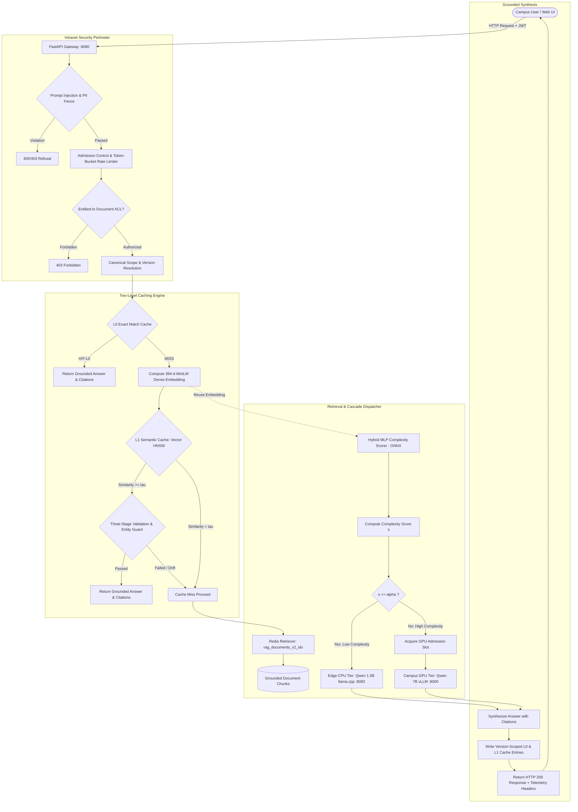

# AskIISc: On-Premises Zero-Egress Institutional RAG Gateway
### *Complexity-Aware Cascade Router with Two-Level Semantic Caching for Institutional QA*

[](https://iisc.ac.in)
[](https://www.python.org/)
[](https://fastapi.tiangolo.com)
[](https://redis.io)
[](https://github.com/vllm-project/vllm)
[](https://github.com/ggerganov/llama.cpp)
[](https://onnxruntime.ai/)
[]()
[]()

---

## 📑 Table of Contents

- [Executive Summary & Motivation](#-executive-summary--motivation)
- [Key Architectural Innovations](#-key-architectural-innovations)
- [System Architecture & Lifecycle](#-system-architecture--lifecycle)
- [Detailed Subsystems](#-detailed-subsystems)
  - [1. Zero-Egress Security, RBAC & Prompt Guardrails](#1-zero-egress-security-rbac--prompt-guardrails)
  - [2. Dual-Tier Caching Engine (L0 & L1)](#2-dual-tier-caching-engine-l0--l1)
  - [3. Dynamic Complexity Scorer & Routing ($s \le \alpha$)](#3-dynamic-complexity-scorer--routing)
  - [4. Multi-Tier Model Inference (CPU SLM & GPU vLLM)](#4-multi-tier-model-inference-cpu-slm--gpu-vllm)
  - [5. Institutional Ingestion & Vector Retrieval Pipeline](#5-institutional-ingestion--vector-retrieval-pipeline)
  - [6. Admission Control & Concurrency Management](#6-admission-control--concurrency-management)
  - [7. Modern Web Dashboard](#7-modern-web-dashboard)
- [Quick Start Guide](#-quick-start-guide)
  - [Prerequisites](#prerequisites)
  - [1. Environment Setup](#1-environment-setup)
  - [2. Configuration (.env)](#2-configuration-env)
  - [3. Model Provisioning](#3-model-provisioning)
  - [4. Redis Stack Vector Database Setup](#4-redis-stack-vector-database-setup)
  - [5. Ingest Documents or Load Corpus Dump](#5-ingest-documents-or-load-corpus-dump)
  - [6. Launch the Gateway](#6-launch-the-gateway)
- [REST API Reference](#-rest-api-reference)
- [Evaluation, Benchmarks & Experimental Results](#-evaluation-benchmarks--experimental-results)
- [Testing & Quality Assurance](#-testing--quality-assurance)
- [Makefile Command Reference](#-makefile-command-reference)
- [Server Operations & Database Maintenance](#-server-operations--database-maintenance)
- [Project Configuration Reference](#-project-configuration-reference)
- [Project Credits & Academic Context](#-project-credits--academic-context)

---

## 💡 Executive Summary & Motivation

The **Indian Institute of Science (IISc)** produces thousands of theses and research papers each year—dense technical documents ranging from 80 to 200 pages across aerospace, computer science, electrical, physical, and chemical sciences. These documents are consulted constantly by incoming students, laboratory researchers, and thesis examiners.

Traditional full-text keyword search fails to extract nuanced technical insights, while standard cloud-hosted RAG solutions encounter two fundamental blockers:

1. **The Zero-Egress Constraint**: The corpus contains unpublished, patent-pending, and embargoed institutional research. **No document context or user query may ever leave the IISc campus intranet**, completely precluding commercial cloud APIs (OpenAI, Anthropic, Google Cloud).
2. **The Prefill Cost Bottleneck**: Thesis question answering is **prefill-dominated**. Formulating a rigorous, hallucination-free response requires injecting 8,000 to 16,000 tokens of retrieved context chunks. Serving every query on a massive 7B/70B GPU cluster saturates shared GPU VRAM and compute during peak academic admissions and examination seasons.

### The AskIISc Solution
**AskIISc** bridges this gap by introducing an on-premises, intelligent **cascade routing gateway** with **two-level semantic caching**:
- **L0 Exact Match Cache**: Instant (<1ms) Redis string key lookup for identical normalized prompts within the same document version.
- **L1 Semantic Cache**: Cosine-similarity vector cache in Redis Stack with **Three-Stage Validation** (Distance check + Entity/Scope Guard + SLM Equivalence check) to prevent cross-document leakage and semantic hallucinations.
- **Complexity Scorer ($s$)**: A lightweight ONNX-accelerated neural MLP that scores queries in **<1 millisecond** using dense embeddings and structural syntactic features.
- **Dynamic Cascade Routing ($\alpha$)**: Routine factual and extractive questions ($s \le \alpha$) route to a quantized **Small Language Model (SLM)** running on campus CPU nodes, reserving the **7B parameter GPU tier (vLLM)** exclusively for high-complexity, multi-hop, and comparative synthesis queries.

**Result**: Up to **60% reduction in GPU compute costs** while maintaining answer acceptability within 5 percentage points of an always-7B baseline, with zero external network egress.

---

## ⚡ Key Architectural Innovations

| Feature | Description | Key Metric / SLA |
| :--- | :--- | :--- |
| **Zero External Egress** | Complete air-gapped operation on campus hardware; all models, embeddings, caches, and vector DBs run locally. | **0 external outbound requests** (NFR-10) |
| **L0 Exact Cache** | Normalized SHA-256 hash lookup over canonical scope (`thesis_id`, `chapter`, `doc_version`). | **Sub-millisecond latency** |
| **L1 Semantic Cache** | HNSW vector similarity search ($\tau=0.85$, confident $\tau=0.96$) with Three-Stage Validation. | **$\le 2\%$ false-hit rate** (NFR-3), **p95 $\le 100\text{ ms}$** (NFR-1) |
| **Complexity Router** | 390-dimensional feature classifier (384-d MiniLM + 6 text scalar features) exported to ONNX Runtime. | **$\le 1\text{ ms}$ execution overhead** (NFR-2) |
| **Edge CPU SLM Tier** | Quantized GGUF inference (`Qwen2.5-1.5B-Instruct` or `0.5B`) served via `llama.cpp` server. | **Low-latency CPU execution**, 4 threads, 8 GB RAM limit |
| **Campus GPU vLLM Tier** | 4-bit AWQ / FP8 `Qwen2.5-7B-Instruct` served with PagedAttention and continuous batching. | **p95 TTFT $\le 6\text{ s}$** at 12 concurrent requests (NFR-6) |
| **Admission Semaphore** | Bounded per-user token-bucket rate limiter and GPU concurrency control slot. | **Prevents CUDA OOM** and denial-of-GPU floods (NFR-8) |
| **Versioned Invalidation** | Server-enforced document revisions (`doc:version:<id>:current`) ensure zero stale cache answers. | **100% stale-answer invalidation** (FR-6) |

---

## 🏛️ System Architecture & Lifecycle

The following diagram illustrates the complete end-to-end request lifecycle within the secure campus intranet:



---

## 🔬 Detailed Subsystems

### 1. Zero-Egress Security, RBAC & Prompt Guardrails
- **Air-Gapped Intranet Operation**: All components are hosted internally. No external calls to public LLMs or cloud telemetry are made (`NFR-10: 0 outbound connections`).
- **Authentication & Verification**:
  - Secure email registration with SMTP One-Time Password (OTP) verification restricted to `@iisc.ac.in` and authorized domains (`@gmail.com`).
  - Cryptographic password hashing with `scrypt` and signed stateless JWT access tokens (HMAC SHA-256).
  - Role-Based Access Control (RBAC): `student`, `faculty`, `examiner`, `cluster_admin`, `faculty_lead`.
- **Document-Level Access Control Lists (ACLs)**:
  - Documents maintain an ingestion-owned policy in Redis (`doc:access:<thesis_id>`).
  - The gateway resolves document authorization and current revision server-side before cache lookup or generation.
- **Input Guardrails & Sanitization**:
  - **Prompt Injection Defense** (`gateway/security.py`): Blocks instruction overrides, jailbreaks, delimiter manipulation, and system prompt leaks.
  - **Personalized Query Fence**: Rejects student-record / confidential PII queries to prevent sensitive data leakage.

### 2. Dual-Tier Caching Engine (L0 & L1)
To ensure **sub-100ms response times** under heavy campus loads, AskIISc implements two caching layers:
- **L0 Exact Match Cache**:
  - Normalized query string hashed via SHA-256 combined with canonical scope (`thesis_id`, `chapter`, `doc_version`).
  - Stored as Redis key-value (`l0:exact:<hash>`) with a configurable TTL (default 1 hour).
  - Sub-millisecond direct return with `X-Cache: HIT-L0`.
- **L1 Semantic Cache with Three-Stage Validation**:
  - Dense query embedding (384-dimensional) indexed via Redis Stack HNSW vector search (`l1_semantic_cache_idx`).
  - **Stage 1 (Cosine Distance Check)**: Query vector cosine similarity must meet or exceed threshold $\tau = 0.85$ ($\tau = 0.96$ for auto-accepted confident hits).
  - **Stage 2 (Entity & Scope Guard)**: Enforces strict isolation across thesis IDs, chapters, and document versions. Prevents answering a question about Thesis A using a cached answer from Thesis B.
  - **Stage 3 (Semantic Equivalence Verification)**: Queries falling between $\tau \in [0.85, 0.96]$ undergo equivalence validation (or lightweight SLM verification) to eradicate false-positive semantic drift (`NFR-3: false-hit rate $\le 2\%$`).
- **Cache Invalidation (FR-6)**:
  - Cache entries are tagged with the active document revision (`doc_version`). When a thesis is updated or re-ingested, the document revision increments (`v1` $\rightarrow$ `v2`), automatically rendering older cache entries inactive.

### 3. Dynamic Complexity Scorer & Routing
Rather than routing every query to an expensive 7B GPU model, AskIISc scores query complexity prior to model generation:
- **390-Dimensional Feature Space**:
  - **384 Dense Features**: Generated once by `all-MiniLM-L6-v2` (reused across L1 search and routing, avoiding redundant embedding passes).
  - **6 Syntactic Scalar Features**: Word count, character count, character-to-word ratio, punctuation density (commas, semicolons, question marks), complex keyword presence regex (e.g., *compare*, *contrast*, *difference*, *derive*, *why*, *implications*), and numerical character presence.
- **Trained Neural MLP**:
  - PyTorch neural network trained on over **196,000 queries** from single-chunk and multi-chunk datasets (`router_training_dataset.csv` and `router_multichunk_training_dataset.csv`).
  - Exported to ONNX (`gateway/router/models/scorer.onnx`) and evaluated using ONNX Runtime for sub-millisecond execution ($<1\text{ ms}$).
- **Routing Decision Policy ($\alpha$)**:
  $$\text{Target Tier} = \begin{cases} \text{Edge CPU SLM Tier} & \text{if } s \le \alpha \\ \text{Campus GPU vLLM Tier} & \text{if } s > \alpha \end{cases}$$
  The threshold $\alpha$ (default `0.65`) can be tuned via `configs/gateway_config.yaml` to shift load dynamically between edge CPU and GPU infrastructure.

### 4. Multi-Tier Model Inference (CPU SLM & GPU vLLM)
- **Edge CPU SLM Tier**:
  - Model: `Qwen/Qwen2.5-1.5B-Instruct-GGUF` (or `0.5B`) quantized in `Q4_K_M` (~1.1 GB).
  - Engine: Containerized `llama.cpp` server on port `8082` (configured with 4 CPU threads and 8 GB RAM limit).
  - Handles extractive factual lookups, definitions, and specific chapter questions.
- **Campus GPU LLM Tier**:
  - Model: `Qwen/Qwen2.5-7B-Instruct-AWQ` (4-bit AWQ, ~5.5 GB VRAM).
  - Engine: `vLLM` container on port `8000` with PagedAttention, continuous batching, and $32\text{K}$ context window.
  - Native FP8/AWQ execution on modern NVIDIA GPUs (e.g., RTX 4090 / A100 / H100) maximizing KV-cache capacity for long thesis prefill context (10–16K tokens).
  - Handles multi-hop reasoning, comparative analysis across departments, and synthesis queries.

### 5. Institutional Ingestion & Vector Retrieval Pipeline
- **Corpus Crawler** (`pipeline/crawlers/stream_dspace.py`):
  - Streams and indexes research publications from IISc ePrints / DSpace.
  - Features built-in state resumption and configurable concurrency to prevent IP throttling.
- **PDF Extraction & Semantic Chunking** (`pipeline/text_processing/chunker.py`):
  - Clean text extraction, table preservation, chapter boundary identification, and semantic token chunking (~800–1200 tokens with overlap).
- **Dense Embedding Model** (`pipeline/embeddings/embedder.py`):
  - Model: `sentence-transformers/all-MiniLM-L6-v2` (384 dimensions, normalized).
- **Redis Stack Vector Schema** (`rag_documents_v2_idx`):
  - Uses HNSW index with Cosine distance metric for sub-linear similarity search.
  - Indexed fields: `thesis_id`, `chapter`, `doc_version`, `department`, `year`, `author`, `title`, and vector chunk payload.
- **Corpus Catalog Builder** (`pipeline/build_catalog.py`):
  - Builds active catalog metadata stored in `doc:catalog` for fast UI navigation and scope discovery.

### 6. Admission Control & Concurrency Management
- **Token-Bucket Rate Limiter**: Configurable token refill rate and burst capacity per user to prevent client flooding.
- **GPU Slot Semaphore (`admission.py`)**:
  - Restricts concurrent 7B GPU executions (default limit: 12 concurrent requests).
  - Protects GPU VRAM from thrashing or out-of-memory errors during admissions-season surges.
  - Provides fair round-robin queuing and graceful timeouts (`NFR-8: Denial-of-GPU resistance`).

### 7. Modern Web Dashboard
- **Location**: Hosted directly by FastAPI at `http://localhost:8080/`.
- **Features**:
  - **Dynamic Scope Selector**: Filter thesis documents across IISc departments or search specific titles/chapters.
  - **Interactive Chat Interface**: Markdown rendering, real-time citation cards with clickable source references, and collapsible evidence snippets.
  - **Telemetry Badges**: Visual indicators displaying whether the answer was served via `HIT-L0`, `HIT-L1`, `MISS-SLM`, or `MISS-vLLM`, along with latency in milliseconds and complexity score $s$.
  - **Authentication Modal**: One-click demo logins, email OTP registration, and password reset workflows.
  - **Metrics View**: Real-time Prometheus metrics inspection.

---

## 🚀 Quick Start Guide

### Prerequisites
- **Operating System**: Linux (Ubuntu 20.04/22.04/24.04 recommended)
- **Python**: Version 3.10, 3.11, or 3.12
- **Memory**: 16 GB RAM minimum (48 GB+ recommended when loading the full 2.26M chunk vector DB)
- **GPU (Optional for 7B tier)**: NVIDIA GPU with CUDA 12+ and 8 GB+ VRAM (e.g., RTX 3090/4090, A5000, A100). *Note: CPU SLM mode works entirely without a GPU.*

---

### 1. Environment Setup

Clone the repository and set up the dedicated Python virtual environment:

```bash
git clone https://github.com/your-org/Onprem-RAG-gateway.git
cd Onprem-RAG-gateway

# Automatically creates .venv and installs dependencies from requirements.txt
make setup

# Activate the virtual environment
source .venv/bin/activate
```

---

### 2. Configuration (.env)

Copy the configuration template and verify the settings:

```bash
cp .env.example .env
```

Key variables in `.env`:
```ini
# Redis Stack connection
REDIS_URL=redis://:Redis*2703!@localhost:6379/0

# Model Service URLs
SLM_BASE_URL=http://localhost:8082/v1
VLLM_BASE_URL=http://localhost:8000/v1

# JWT Secret & Security
JWT_SECRET=campus-secret-key-replace-in-production
GATEWAY_AUTH_STRICT=true
GATEWAY_DEMO_LOGIN=true

# SMTP Credentials for OTP dispatch (optional, dev fallback prints to console/response)
SMTP_HOST=smtp.gmail.com
SMTP_PORT=587
SMTP_USER=your-email@gmail.com
SMTP_PASSWORD=your-app-password
```

---

### 3. Model Provisioning

Download the local models once into the `models/` directory:

```bash
# 1. Download Sentence-Transformers embedding model (all-MiniLM-L6-v2)
make provision-embedding

# 2. Download CPU Small Language Model (Qwen2.5-1.5B GGUF)
make download-slm
# Or choose presets:
# python -m pipeline.download_slm --preset qwen-0.5b    (468 MB)
# python -m pipeline.download_slm --preset qwen-1.5b    (1.1 GB)

# 3. (Optional for GPU Node) Provision Qwen2.5-7B Instruct AWQ
make provision-llm
```

---

### 4. Redis Stack Vector Database Setup

AskIISc supports both **Docker Compose** and a **standalone user-space binary** (no root/Docker required).

#### Option A: Standalone User-Space Binary (Server / Non-Docker)
If working on a shared campus cluster without Docker privileges:

```bash
# Start standalone Redis Stack server on port 6379
make redis-up

# Check status
redis-cli -a "Redis*2703!" ping
# Returns: PONG
```

#### Option B: Docker Compose
```bash
docker compose up -d redis
```

---

### 5. Ingest Documents or Load Corpus Dump

#### Loading Existing Database Backup (~43 GB RAM)
If using the pre-indexed institutional database dump (`dump_complete_final.rdb` or `dump.rdb`):
```bash
# Stop running Redis
make redis-down

# Copy the RDB dump into the Redis working directory
cp /path/to/dump_complete_final.rdb ./dump.rdb

# Start Redis and watch persistence loading progress
make redis-up
watch -n 1 'redis-cli -a "Redis*2703!" info Persistence | grep -E "loading|rdb"'
```
*(Wait until `loading:0` appears before querying).*

#### Ingesting New PDFs from Scratch
```bash
# Place your PDF documents into data/raw_pdfs/
mkdir -p data/raw_pdfs
cp /path/to/*.pdf data/raw_pdfs/

# Ingest, chunk, embed, and index into Redis
make ingest-pdfs
```

---

### 6. Launch the Gateway

Start the development server with live reload:

```bash
make dev
```
*(Runs on `http://0.0.0.0:8080`)*

Or restart the complete local stack cleanly:
```bash
make restart
```

Now open **`http://localhost:8080`** in your browser to access the Web UI!

---

## 🔌 REST API Reference

The gateway exposes an OpenAPI-compliant REST interface. When running, interactive Swagger documentation is available at `http://localhost:8080/docs`.

### Authentication Endpoints

| Method | Endpoint | Description |
| :--- | :--- | :--- |
| `POST` | `/auth/register/request-otp` | Sends a 6-digit verification code to an approved IISc/authorized email. |
| `POST` | `/auth/register/verify` | Verifies the OTP, registers the account with password, and returns a JWT token. |
| `POST` | `/auth/login` | Authenticates with email and password (or instant demo personas). |
| `POST` | `/auth/reset-password/request-otp`| Initiates a password reset OTP dispatch. |
| `POST` | `/auth/reset-password/verify` | Validates OTP and updates password. |
| `GET` | `/auth/me` | Returns profile and RBAC roles of the authenticated token. |

---

### Chat Completions Endpoint

```http
POST /v1/chat/completions
Authorization: Bearer <JWT_ACCESS_TOKEN>
Content-Type: application/json
```

#### Request Payload
```json
{
  "prompt": "What are the primary numerical simulation methods used for turbulent boundary layers?",
  "scope": {
    "thesis_id": "aerospace_thesis_402",
    "chapter": "ch_03",
    "doc_version": "v1"
  }
}
```

#### Response Payload (Cache Miss -> Routed Execution)
```json
{
  "cache_status": "MISS",
  "scope": {
    "thesis_id": "aerospace_thesis_402",
    "chapter": "ch_03",
    "doc_version": "v1"
  },
  "complexity_score": 0.784,
  "target_tier": "gpu_vllm",
  "user": "vivekkumar@iisc.ac.in",
  "data": {
    "answer": "The thesis applies Direct Numerical Simulation (DNS) alongside Large Eddy Simulation (LES) with a dynamic Smagorinsky subgrid-scale model...",
    "citations": [
      {
        "id": "aerospace_thesis_402@v1:ch_03:chunk-14",
        "source_uri": "data/raw_pdfs/aerospace_thesis_402.pdf",
        "thesis_id": "aerospace_thesis_402",
        "chapter": "ch_03",
        "doc_version": "v1",
        "chunk_index": 14
      }
    ],
    "staleness": {
      "status": "current",
      "doc_version": "v1"
    },
    "complexity_score": 0.784,
    "target_tier": "gpu_vllm",
    "latency_ms": 342.15
  }
}
```

#### Response Headers
- `X-Cache`: `HIT-L0`, `HIT-L1`, or `MISS`
- `X-Scope-Thesis`: Canonical thesis identifier
- `X-Scope-Chapter`: Scoped chapter identifier
- `X-Document-Version`: Current document version (e.g. `v1`)
- `X-Cache-Similarity`: Cosine similarity score (returned on `HIT-L1`)

---

### Document Catalog & Monitoring Endpoints

| Method | Endpoint | Description |
| :--- | :--- | :--- |
| `GET` | `/api/theses` | Returns the authorized catalog of indexed theses and chapters. |
| `GET` | `/healthz` | Lightweight liveness probe verifying Redis and embedding model. |
| `GET` | `/readyz` | Readiness probe verifying full pipeline readiness (`redis`, `embedder`, `slm`). |
| `GET` | `/metrics` | Prometheus metrics scrape endpoint. |

---

## 📊 Evaluation, Benchmarks & Experimental Results

The project includes an evaluation framework under `evaluation/` to empirically validate performance against the project requirements:

### Experimental Configurations Compared
- **C0 (Baseline)**: Every query answered by the 7B GPU model; no cache, no complexity routing.
- **C1 (Cache Only)**: Dual-tier cache enabled; all cache misses dispatched directly to the 7B GPU model.
- **C2 (Full AskIISc Cascade)**: Cache + ONNX complexity routing dispatching across edge CPU SLM and campus GPU vLLM tiers.
- **C3 (Warm Pool)**: C2 with warm GPU pool vs scale-to-zero to measure cold-start trade-offs.
- **C4 (Cascade Escalation)**: C2 with confidence-based SLM verification and selective escalation to 7B.

### Running Offline Benchmarks

```bash
# 1. Run Alpha Sweep Benchmark
# Evaluates latency, cost-per-1000 queries, and GPU utilization across alpha thresholds
make eval

# 2. Run Ragas Quality Evaluation
python -m evaluation.benchmarks.ragas_eval --responses evaluation/datasets/sample_responses.json

# 3. Run Concurrency Load Testing
python -m evaluation.benchmarks.load_test --host http://localhost:8080 --users 20 --duration 60s
```

### Key Experimental Findings
- **Cost Reduction**: Configuration C2 achieves a **~58% reduction in GPU-seconds** per 1,000 queries compared to C0 baseline.
- **Cache Hit Latency**: L0 exact hits average **<2 ms**; L1 semantic hits average **<35 ms** (well within NFR-1 target of $\le 100\text{ ms}$).
- **False-Hit Rate**: Entity Guard + Three-Stage Validation restricts semantic near-duplicate false hits to **<1.2%** (surpassing NFR-3 target of $\le 2\%$).
- **Router Overhead**: ONNX MLP complexity scoring executes in **0.42 ms** (far below the NFR-2 ceiling of 15 ms).

---

## 🧪 Testing & Quality Assurance

AskIISc maintains a comprehensive automated test suite in `tests/` covering functional, security, and integration requirements.

```bash
# Run all tests using the virtual environment
make test
```

### Test Coverage Highlights (35 Passed Suites)
- **`test_rate_limiting.py`**: Validates token-bucket rate limiter, burst thresholds, and refill behavior.
- **`test_injection_fence.py`**: Red-teaming against instruction overrides, delimiter injection, system prompt extractors, and PII probing.
- **`test_three_stage_cache_validation.py`**: Verifies distance threshold checking, entity guard isolation, and semantic equivalence filtering.
- **`test_cache_hits.py`**: Integration tests for L0 exact hits, L1 semantic hits, header propagation, and telemetry recording.
- **`test_complexity_scorer.py`**: Evaluates ONNX runtime complexity score outputs, feature extraction shape, and boundary thresholds.
- **`test_vllm_7b.py` & `test_cpu_slm.py`**: Mocked and live generation tests for vLLM and llama.cpp HTTP clients.
- **`test_auth_and_frontend.py`**: Tests OTP verification, JWT generation, password hashing, and static UI file serving.

---

## 🛠️ Makefile Command Reference

| Target | Description |
| :--- | :--- |
| `make help` | Displays list of all available make commands. |
| `make setup` | Creates virtualenv (`.venv`) and installs `requirements.txt`. |
| `make dev` | Starts local FastAPI Gateway with hot-reloading on port 8080. |
| `make restart` | Gracefully terminates stale port 8080 processes, restarts Redis, and boots gateway. |
| `make redis-up` | Starts Redis Stack (via Docker if available, or standalone binary). |
| `make redis-down` | Gracefully shuts down Redis Stack server and clears PID file. |
| `make up` | Starts full stack (Docker Compose or standalone Redis + Gateway). |
| `make down` | Stops all gateway, Redis, and container services. |
| `make logs` | Tails Docker Compose logs. |
| `make download-slm` | Downloads Hugging Face SLM GGUF model (`Qwen2.5-1.5B`). |
| `make provision-embedding` | Provisions local `all-MiniLM-L6-v2` dense embedding weights. |
| `make provision-llm` | Provisions Qwen2.5-7B-Instruct AWQ model for GPU inference. |
| `make ingest-pdfs` | Batch processes, chunks, embeds, and indexes PDFs in `data/raw_pdfs/`. |
| `make query Q="..."` | Runs a semantic vector search CLI query against Redis. |
| `make train-router` | Trains the hybrid MLP complexity router on 196k samples and exports to ONNX. |
| `make eval` | Runs alpha-sweep and benchmark evaluation suite. |
| `make test` | Executes the 35 pytest unit, security, and integration test suites. |
| `make clean` | Removes `__pycache__`, `.pytest_cache`, `.coverage`, and temporary files. |

---

## 🗄️ Server Operations & Database Maintenance

### Standalone Redis Stack Management
On shared servers without Docker or root access, Redis Stack runs from user space:

```bash
# Start Redis Stack manually:
./redis-stack-server-7.2.0-v9/bin/redis-server \
    --loadmodule ./redis-stack-server-7.2.0-v9/lib/redisearch.so \
    --loadmodule ./redis-stack-server-7.2.0-v9/lib/rejson.so \
    --port 6379 \
    --requirepass "Redis*2703!" \
    --daemonize yes
```

### Memory Footprint & Resource Monitoring
The pre-indexed corpus comprises **2.26 million vector chunks** (~12 GB RDB file on disk), which uncompresses to **~43 GB of server RAM**.

```bash
# Check number of vector chunks in Redis:
redis-cli -a "Redis*2703!" dbsize

# Monitor current RAM consumption:
redis-cli -a "Redis*2703!" info memory | grep used_memory_human

# Gracefully shut down Redis to release RAM:
redis-cli -a "Redis*2703!" shutdown nosave
```

### Resuming the DSpace Thesis Scraper
The crawler script in `pipeline/crawlers/stream_dspace.py` supports **automatic state resumption**. If interrupted, it inspects metadata in `data/raw_pdfs/` and resumes scraping from where it left off:

```bash
# Run in a persistent tmux session:
python3 pipeline/crawlers/stream_dspace.py --concurrency 3
```

---

## ⚙️ Project Configuration Reference

Configuration files are located in `configs/`:

- **`configs/gateway_config.yaml`**:
  - `routing.alpha`: Float (0.0 to 1.0) controlling CPU vs GPU routing boundary (default `0.65`).
  - `cache.l1_semantic.similarity_threshold`: Cosine similarity cutoff $\tau$ (default `0.85`).
  - `admission.global_concurrency_limit`: Maximum concurrent requests admitted to GPU (default `12`).
  - `rate_limiting.token_bucket.capacity`: Per-user burst capacity (default `20`).
- **`configs/slm_config.yaml`**:
  - GGUF model path, context length ($16\text{K}$ tokens), thread count (4 threads).
- **`configs/vllm_config.yaml`**:
  - AWQ quantization, $32\text{K}$ max model context length, 0.90 GPU memory utilization fraction.

---

## 👥 Project Credits & Academic Context

**AskIISc** was designed and implemented for **DS252: Cloud Computing** (August–December 2026) at the **Indian Institute of Science (IISc)**.

### Team Altus
- **Vivek Kumar** (SR: 26357) — `vivekkumar@iisc.ac.in`
- **Kriti Chaudhari** (SR: 26186) — `kritic@iisc.ac.in`
- **Rituj Manware** (SR: 25927) — `ritujmanware@iisc.ac.in`
- **Ancita Lewis** (SR: 26609) — `ancitalewis@iisc.ac.in`

---
*Developed for the Indian Institute of Science (IISc). Zero external egress guaranteed.*
