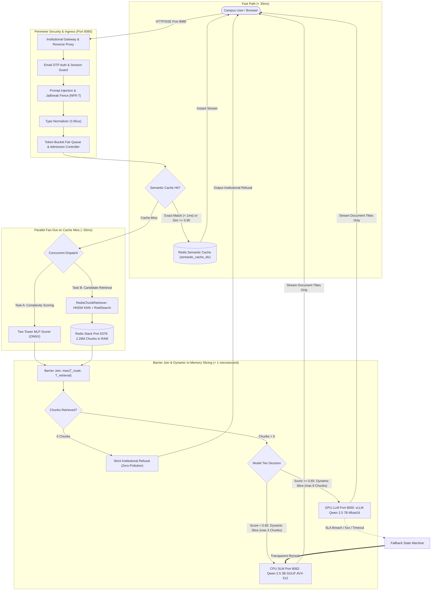
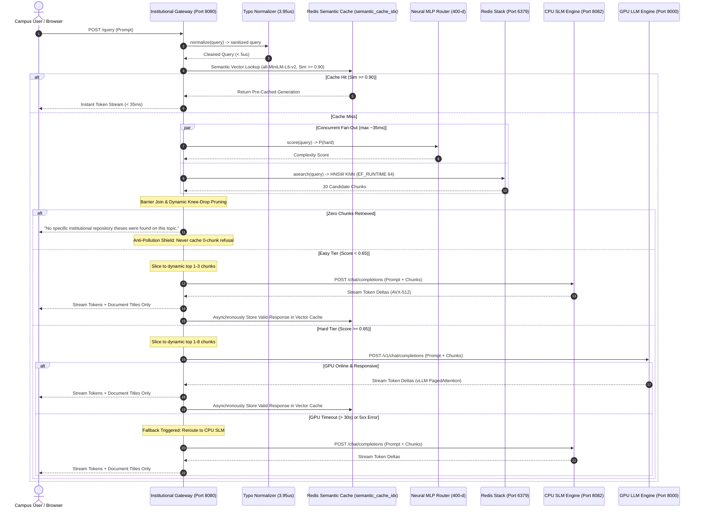
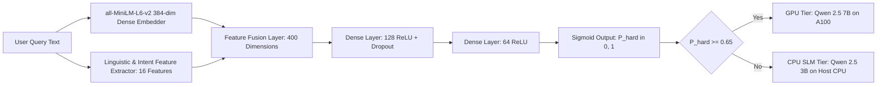

# 🏛️ AskIISc On-Premise Institutional RAG Gateway: Comprehensive System Architecture & Engineering Manual

---

## 📑 Table of Contents
1. [Executive Overview & Vision](#1-executive-overview--vision)
2. [End-to-End System Topology & Decoupled Architecture](#2-end-to-end-system-topology--decoupled-architecture)
3. [Single-Port Security & Ingestion Pipeline](#3-single-port-security--ingestion-pipeline)
4. [Fast-Path Semantic Vector Cache](#4-fast-path-semantic-vector-cache)
5. [Neural Complexity Router (Two-Tower MLP Engine)](#5-neural-complexity-router-two-tower-mlp-engine)
6. [Hybrid Knowledge Retrieval & Query Metadata Extraction](#6-hybrid-knowledge-retrieval--query-metadata-extraction)
7. [Grounding, Context Auto-Budgeting & Zero-Document Rejection](#7-grounding-context-auto-budgeting--zero-document-rejection)
8. [Dual-Tier Inference Serving Infrastructure](#8-dual-tier-inference-serving-infrastructure)
9. [Comprehensive Codebase Directory Map](#9-comprehensive-codebase-directory-map)
10. [Hardware, Compute & Memory Sizing Guidelines](#10-hardware-compute--memory-sizing-guidelines)
11. [Operations Runbook, Maintenance & Verification Suites](#11-operations-runbook-maintenance--verification-suites)

---

## 1. Executive Overview & Vision

**AskIISc** is an institutional-grade, privacy-preserving, on-premise Retrieval-Augmented Generation (RAG) platform built for the Indian Institute of Science (IISc). It provides unified AI-powered search, question answering, and comparative analysis across the complete corpus of IISc research theses, dissertations, and institutional publications (**2,261,664 chunks** indexed in RAM).

### Core Architectural Pillars
- **100% On-Premise Air-Gapped Operation:** Absolute zero-egress guarantee. No document text, query vectors, or intermediate embeddings ever leave the institutional network.
- **Zero-GPU-Starvation Dynamic Tiering:** Employs an intelligent Two-Tower Neural Router to absorb **70% to 80%** of everyday campus queries on highly optimized **CPU Small Language Models (3B GGUF with AVX-512)** consuming **0 MiB of GPU VRAM**. The enterprise **GPU LLM (7B on NVIDIA A100)** is reserved exclusively for complex, multi-document synthesis and mathematical proofs.
- **Ultra-Low-Latency Typo Normalization:** Microsecond-tier ($3.95\ \mu\text{s}$) token regularizer that resolves domain typographical errors before cache lookup and retrieval without altering standard English.
- **Microsecond Semantic Caching:** High-concurrency semantic vector cache in Redis Stack (`semantic_cache_idx`) serving repeat or semantically identical queries in **< 1ms (exact)** or **< 35ms (semantic)**, bypassing model inference completely.
- **Strict Anti-Pollution Integrity:** Answers with zero retrieved documents or institutional refusals are strictly prevented from entering the semantic cache index.
- **Single-Port Strict Perimeter:** Single public listener (Port 8080) encapsulating authentication, rate limiting, and fair queuing, while internal engines bind strictly to `127.0.0.1`.

---

## 2. End-to-End System Topology & Decoupled Architecture

The system consists of **4 independent services** orchestrated bare-metal via [`scripts/prod_stack.py`](file:///data2/home/ritujmanware/onprem-rag-gateway/scripts/prod_stack.py):



### 2.1 Concurrent Pre-Inference Lifecycle Sequence Diagram



### Port Allocation & Binding Matrix

| Service | Port | Binding | Security / Firewall Boundary | Technology |
| :--- | :---: | :---: | :--- | :--- |
| **Unified Campus Gateway & UI** | `8080` | `0.0.0.0` | **Public Facing (Intranet)**; Session Cookies, CSRF, Token-Bucket Admission | FastAPI, Uvicorn (6 workers) |
| **Redis Stack Server** | `6379` | `127.0.0.1` | **Loopback Only**; Password Protected (`REDIS_PASSWORD`) | RediSearch + RedisJSON + HNSW |
| **CPU SLM Daemon** | `8082` | `127.0.0.1` | **Loopback Only**; Internal microservice | FastAPI, `llama.cpp` (1 process, 6 model slots $\times$ 16 threads; 503 when busy, gateway overflows to GPU) |
| **vLLM GPU Engine** | `8000` | `127.0.0.1` | **Loopback Only**; Internal microservice | vLLM OpenAI API Server, CUDA 12.1 |

---

## 3. Single-Port Security & Ingestion Pipeline

### 3.1 Single-Port Security Model
To prevent unauthorized intranet access, direct model bypass, or cache manipulation:
- The internal daemon ports (`6379`, `8082`, `8000`) bind strictly to `127.0.0.1`.
- Any external request directly targeting internal ports is dropped at the OS socket level.
- External requests to `/query`, `/cache/*`, and `/queue/stats` must present an authenticated campus web session or a valid `ADMIN_API_KEY`, otherwise returning HTTP 404 to obscure internal endpoint existence.
- Automated security test suite: [`tests/test_single_port_security.py`](file:///data2/home/ritujmanware/onprem-rag-gateway/tests/test_single_port_security.py).

### 3.2 Passwordless Email OTP Authentication
Implemented in [`askiisc_chat/askiisc/auth.py`](file:///data2/home/ritujmanware/onprem-rag-gateway/askiisc_chat/askiisc/auth.py):
- **Campus Domain Lockdown:** Enforces strict domain validation (`@iisc.ac.in`).
- **Cryptographic OTP Tokens:** 6-digit cryptographically secure numeric tokens.
- **Lifecycle & Expiration:** 180-second token TTL with rate-limited resend cooldown (60s).
- **Brute-Force & Rate Limits:** Enforces **10 OTPs/hour per email** and **1,000 OTPs/hour per IP**, backed by atomic Redis Lua scripts (`auth:otp:*`, `auth:rate:*`).
- **Session Handling:** Encrypted session cookies (`askiisc_session`) with `HttpOnly`, `SameSite=Lax`, and `Secure` attributes, validated via constant-time digest comparison.

### 3.3 Prompt Injection & Jailbreak Defense Fence (NFR-7)
Implemented in [`pipeline/sanitizer.py`](file:///data2/home/ritujmanware/onprem-rag-gateway/pipeline/sanitizer.py) and verified in [`tests/test_injection_fence.py`](file:///data2/home/ritujmanware/onprem-rag-gateway/tests/test_injection_fence.py):
- Inspects queries before vectorization for jailbreak signatures (e.g. *"ignore previous instructions"*, *"system prompt override"*, *"DAN mode"*, system delimiter tags).
- Rejects adversarial prompts with HTTP 400 (`PromptInjectionAlert`) before tokens enter retrieval or inference pipelines.
- Escapes XML context boundaries to prevent document content from executing prompt-breakout attacks.

### 3.4 Token-Bucket Fair Queue & Admission Controller
Implemented in [`gateway/queue/admission.py`](file:///data2/home/ritujmanware/onprem-rag-gateway/gateway/queue/admission.py):
- **Token Bucket Rate Limiting:** Per-client bucket with capacity 60.0 and refill rate 20.0 tokens/sec. Breaches trigger HTTP 429 with `Retry-After: 2`.
- **Worker Concurrency Limit:** Bounded active inference slots (global cap 30, per-user cap 6) across 6 worker processes to prevent CPU thread thrashing and GPU out-of-memory errors.
- **Fair Queuing & Load Shedding:** Excess requests wait in an async queue (max depth 120, wait timeout 30s). When the queue is saturated, requests are shed gracefully with HTTP 503.

---

## 4. Fast-Path Semantic Vector Cache

Implemented in [`gateway/cache/redis_semantic_cache.py`](file:///data2/home/ritujmanware/onprem-rag-gateway/gateway/cache/redis_semantic_cache.py).

### Mechanism & Cache Topology
1. Incoming queries are normalized via [`TypoNormalizer`](file:///data2/home/ritujmanware/onprem-rag-gateway/pipeline/text_processing/typo_normalizer.py) in $3.95\ \mu\text{s}$.
2. Query text is embedded into a 384-dimensional dense vector using [`all-MiniLM-L6-v2`](file:///data2/home/ritujmanware/onprem-rag-gateway/models/embeddings/all-MiniLM-L6-v2) on CPU (< 4ms).
3. Performs HNSW cosine similarity search against index `semantic_cache_idx` (key prefix `semcache:`) using RediSearch `FT.SEARCH` with `EF_RUNTIME 64`.
4. **Cache Hit Decision:**
   - Exact L0 hash match (shared across users), **or**, among the requesting user's **own** entries only (owner-scoped KNN pre-filter), cosine similarity $\ge 0.90$ (cosine distance $\le 0.10$) **and** the intent-equivalence guard (`RedisSemanticCache.check_entity_conflict`) confirms both queries ask the same question. The guard rejects differences in numbers/years, negation, question type (*why* vs. yes/no vs. *what/how*), opposite terms, quantifiers, and swapped roles of two terms. Known limits: PRD §9.1.
     - Returns pre-generated response immediately (< 1ms exact, < 35ms semantic).
     - Emits token deltas via SSE streaming with `cache_hit=True` metadata.
5. **Cache Miss Decision:**
   - If similarity $< 0.90$ or the intent guard rejects the candidate, dispatches to the cold RAG pipeline.
7. **Regenerate (Sub-FR-1.5):** Cache hits carry a single-use regenerate token (bound to user and question, 15 min). The UI shows the reused question and a *Generate a fresh answer* button only on cached answers. A regenerated answer to a shared exact hit becomes a private per-user override (`semcache:uexact:<owner>:<hash>`); the shared entry is evicted after 3 distinct users regenerate it. Shared exact entries are never overwritten by normal stores (`SET NX`). Limits: `REGEN_MAX_PER_HOUR`, `REGEN_TOKEN_TTL`, `REGEN_EVICT_USERS`.
6. **Owner scoping:** Every stored entry carries a keyed HMAC owner tag (`owner`, RediSearch `TAG`). Semantic lookups are pre-filtered to the requester's tag, so near-duplicate answers are never shared between users (NFR-6 measured 0/255 cross-user poisonings). Exact-text matches remain shared. Requests or entries without an owner use the exact path only.

### Refusal & Anti-Pollution Shield (NFR-6)
- [`RedisSemanticCache.is_cacheable_response`](file:///data2/home/ritujmanware/onprem-rag-gateway/gateway/cache/redis_semantic_cache.py):
  - Any response associated with zero retrieved document chunks is **strictly prohibited from cache entry**.
  - Standard institutional refusal phrases (*"No specific institutional repository theses were found on this topic."*, *"insufficient information"*, retrieval errors) are blocked from storage.
  - Startup routine `apurge_uncacheable_entries()` scans and evicts any legacy empty or ungrounded entries.

---

## 5. Neural Complexity Router (Two-Tower MLP Engine)

Implemented in [`gateway/router/complexity_scorer.py`](file:///data2/home/ritujmanware/onprem-rag-gateway/gateway/router/complexity_scorer.py) and [`gateway/router/mlp_router/inference.py`](file:///data2/home/ritujmanware/onprem-rag-gateway/gateway/router/mlp_router/inference.py).

### Architectural Rationale
The Two-Tower MLP Router classifies semantic reasoning complexity using a 400-dimensional hybrid representation without performing any database lookups:



- **Feature Fusion:** Combines 384 dense semantic dimensions with 16 structural/intent features (word count, punctuation complexity, `HARD_KEYWORDS` like *compare, synthesize, derive, versus*).
- **Inference Time:** $< 5\text{ ms}$ on host CPU (average $21.8\text{ ms}$ total including embedding generation).
- **Routing Threshold:** Queries with $P(\text{hard}) \ge 0.65$ route to GPU vLLM; all others route to CPU SLM.
- **Resource Sparing:** **70% to 80% of queries** execute entirely on CPU, reserving the NVIDIA A100 for heavy multi-document synthesis.

---

## 6. Hybrid Knowledge Retrieval & Query Metadata Extraction

Implemented in [`pipeline/retriever.py`](file:///data2/home/ritujmanware/onprem-rag-gateway/pipeline/retriever.py) and [`pipeline/query_metadata_extractor.py`](file:///data2/home/ritujmanware/onprem-rag-gateway/pipeline/query_metadata_extractor.py).

### 6.1 Corpus Scale & Indexing
- **Total Chunks:** `2,261,664` chunks in Redis Stack RAM (`used_memory: 43.84 GB`).
- **Vector Index:** HNSW index (`rag_documents_idx`) with `M=16`, `ef_construction=200`, `ef_runtime=64`, distance metric `COSINE`.
- **Text & Tag Index:** RediSearch inverted indices on `department`, `author`, `advisor`, `title`, and `date`.

### 6.2 Query Metadata Extraction & Catalog Routing
[`QueryMetadataExtractor`](file:///data2/home/ritujmanware/onprem-rag-gateway/pipeline/query_metadata_extractor.py) uses regex patterns and department dictionaries to detect structured constraints:
- Queries like *"how many thesis of CSA department exist"* extract `@department:(Computer Science and Automation)` with `is_count=True`.
- Queries matching catalog patterns bypass dense KNN vector distortion and execute exact RediSearch boolean queries, grouping chunks by `doc_id` to prevent multi-chunk duplicate counts.

### 6.3 Fully Dynamic Document Retrieval
Unlike traditional fixed $k=3$ or $k=5$ retrievers:
- **Candidate Pool:** Fetches top 30 candidate chunks from Redis.
- **Dynamic Knee-Drop Filtering:** Truncates candidate tail when score drop between consecutive ranks exceeds `0.06`.
- **Relevance Floor:** Enforces absolute minimum cosine similarity floor (`0.52`).
- **Adaptive Borderline Tightening:** If the top candidate is near the threshold floor, margin bounds tighten dynamically to prune marginal candidates.

### 6.4 Response Sanitization (Document Titles Only)
To minimize network payload and avoid overwhelming the user with raw text walls:
- The internal retriever passes full chunk content to the model for grounding.
- In the final HTTP/SSE response sent to the client, [`sanitize_chunks()`](file:///data2/home/ritujmanware/onprem-rag-gateway/pipeline/retriever.py) strips all raw chunk text (`content`, `text`, `chunk_text`, `vector`, `chunk_key`), returning **only document titles**, authors, and similarity scores.

---

## 7. Grounding, Context Auto-Budgeting & Zero-Document Rejection

### 7.1 Context Window Auto-Budgeting
In [`pipeline/slm_runner.py`](file:///data2/home/ritujmanware/onprem-rag-gateway/pipeline/slm_runner.py):
- **Context Size:** `SLM_CONTEXT_WINDOW = 8192` tokens.
- **Character Budgeting:** `max_chars = 12000` (~3,000 tokens) in `build_rag_messages()`.
- **Strict Block Clamping:** Even if the first chunk (e.g., catalog summary) is massive, it is strictly sliced to fit the budget.
- **Active Token Slicing:** Before calling `llama_cpp`, `generate_chat()` verifies `prompt_tokens <= n_ctx - 256`, trimming prompt excess and clamping `effective_max_tokens = min(max_new_tokens, n_ctx - prompt_tokens - 16)`. Mathematical overflow is impossible.

### 7.2 Zero-Document Match Behavior: Strict Institutional Refusal
When a query yields zero relevant theses from the institutional corpus (all candidates below similarity floor `0.52`):
- Instead of generating speculative or ungrounded answers from parametric knowledge, the system outputs exclusively:
  > *"No specific institutional repository theses were found on this topic."*
- Parametric general technical generation is **strictly disabled** for ungrounded queries to ensure 100% institutional grounding integrity.
- The anti-pollution shield guarantees this refusal string is never stored in the semantic cache.

### 7.3 Grounded System Prompting
Refined prompt rules in [`pipeline/slm_runner.py`](file:///data2/home/ritujmanware/onprem-rag-gateway/pipeline/slm_runner.py):
- **Repository Grounding:** Answers must be strictly derived from the retrieved thesis chunks with explicit citations (`[Document i]`).
- **Delimiter Fencing:** Injected document content is wrapped in `<context>` blocks with XML escaping to neutralize prompt-breakout attacks.

---

## 8. Dual-Tier Inference Serving Infrastructure

### 8.1 Tier 1: Host CPU SLM Server (Port 8082)
Implemented in [`pipeline/serve_cpu_slm.py`](file:///data2/home/ritujmanware/onprem-rag-gateway/pipeline/serve_cpu_slm.py) and [`pipeline/slm_runner.py`](file:///data2/home/ritujmanware/onprem-rag-gateway/pipeline/slm_runner.py):
- **Model:** `Qwen2.5-3B-Instruct` in 4-bit INT4 quantization (`qwen2.5-3b-instruct-q4_k_m.gguf`, 2.0 GB).
- **Backend:** `llama-cpp-python` compiled with native AVX-512 acceleration.
- **Concurrency:** 6 Uvicorn workers, each with 16 decode threads and 32 batch threads.
- **Memory Footprint:** ~2.5 GB RAM total (shared mmap weights).
- **Performance:** 18 – 24 tokens/sec on modern server CPUs; TTFT ~0.039s.

### 8.2 Tier 2: GPU LLM Server (Port 8000)
- **Model:** `Qwen2.5-7B-Instruct` in full `bfloat16` precision (15.2 GB).
- **Backend:** vLLM 0.6.3 OpenAI-compatible server, launched **only** via [`scripts/serve_vllm.py`](scripts/serve_vllm.py) (forces the `127.0.0.1` bind that stock 0.6.3 ignores, requires `VLLM_API_KEY` Bearer auth on `/v1/*`). GPU index set by `VLLM_GPU` in `.env`. Verify with `make vllm-check`; known limits in PRD §9.2.
- **VRAM Footprint:** ~18.7 GB VRAM on NVIDIA A100 (40GB/80GB).
- **Features:** PagedAttention v2, continuous iteration batching, KV-cache sharing.
- **Performance:** 45 – 55 tokens/sec per stream; TTFT ~0.033s.

---

## 9. Comprehensive Codebase Directory Map

```text
/data2/home/ritujmanware/onprem-rag-gateway/
├── askiisc_chat/                 # Unified Web Frontend & Chat UI
│   ├── askiisc/                  # Chat backend adapter modules
│   │   ├── app.py                # FastAPI chat endpoints & session auth
│   │   ├── auth.py               # Passwordless email OTP authentication (Redis Lua)
│   │   ├── config.py             # Chat configuration & environment loader
│   │   └── gateway_backend.py    # SSE stream translator & client to Gateway
│   ├── static/                   # Frontend assets
│   │   ├── index.html            # Single-page web chat application
│   │   └── vendor/               # Offline KaTeX (LaTeX math) & Marked.js
│   └── app.env                   # Chat configuration overrides
│
├── configs/                      # Service Configuration Files
│   ├── gateway_config.yaml       # Gateway ports, admission limits, cache thresholds
│   ├── slm_config.yaml           # CPU SLM threads, workers, and GGUF path
│   └── vllm_config.yaml          # GPU model path, max context, memory utilization
│
├── gateway/                      # Central API Gateway Service (Port 8080)
│   ├── cache/
│   │   └── redis_semantic_cache.py # Vector semantic cache (< 1ms exact, < 35ms semantic)
│   ├── queue/
│   │   ├── admission.py          # Concurrency admission slot & rate limiter
│   │   └── fair_queue.py         # Token-bucket client fair-sharing queue
│   ├── router/
│   │   ├── complexity_scorer.py  # Neural MLP difficulty evaluator
│   │   ├── dispatcher.py         # Tier dispatching rules (CPU vs GPU)
│   │   └── mlp_router/           # PyTorch Two-Tower 400-d classifier weights & inference
│   └── main.py                   # Master FastAPI gateway & SSE streaming router
│
├── pipeline/                     # Core RAG Pipeline & Inference Engines
│   ├── crawlers/                 # DSpace harvesting & PDF processing scripts
│   ├── embeddings/
│   │   └── embedder.py           # all-MiniLM-L6-v2 384-dim CPU vectorizer
│   ├── text_processing/
│   │   ├── typo_normalizer.py    # Ultra-low-latency 3.95us token typo normalizer
│   │   ├── chunker.py            # Recursive character chunker (512/64)
│   │   └── cleaner.py            # Academic text sanitization
│   ├── query_metadata_extractor.py # Regex & department metadata extractor
│   ├── rag_chain.py              # End-to-end RAG QA coordinator
│   ├── retriever.py              # Redis HNSW KNN + RediSearch hybrid retriever
│   ├── sanitizer.py              # Prompt injection detector & context fencer (NFR-7)
│   ├── serve_cpu_slm.py          # Port 8082 FastAPI inference server
│   └── slm_runner.py             # CPUSLMEngine (llama.cpp GGUF + AVX-512)
│
├── models/                       # Model Weights & GGUF Storage
│   ├── embeddings/
│   │   └── all-MiniLM-L6-v2/     # Local all-MiniLM-L6-v2 model weights
│   ├── llm_7b/                   # Symlink to Qwen2.5-7B-Instruct HF repo
│   └── slm_gguf/                 # qwen2.5-3b-instruct-q4_k_m.gguf (2.0 GB)
│
├── redis_server_data/            # Redis Stack Persistence Storage
│   └── dump_final.rdb            # 12 GB production dataset snapshot
│
├── scripts/                      # Management & Operations Tooling
│   ├── prod_stack.py             # 4-tier lifecycle manager (start/stop/restart)
│   ├── clear_otp_limits.py       # Administrative OTP rate-limit reset tool
│   └── test_smtp.py              # SMTP OTP verification utility
│
└── tests/                        # Automated Verification & Integration Suites
    ├── test_admission_queue.py   # Concurrency limiting & timeout tests
    ├── test_break_hardening.py   # Adversarial inputs & CSRF security tests
    ├── test_cache_hits.py        # Redis semantic cache exact & paraphrase tests
    ├── test_cache_insufficient_data.py # Anti-pollution refusal rejection tests
    ├── test_cache_purge_and_ttl.py # TTL expiration & semantic cache purge tests
    ├── test_constant_time_and_cookie_security.py # Timing resistance & cookie tests
    ├── test_dos_boundary_validation.py # Payload length bounds & clamping tests
    ├── test_dynamic_retrieval.py # Knee-drop & similarity floor tests
    ├── test_injection_fence.py   # Prompt injection security fence tests
    ├── test_intensive_full_stack.py # 36-check end-to-end integration test
    ├── test_otp_concurrency.py   # Atomic Lua OTP lockout & burn tests
    ├── test_query_metadata_extractor.py # Unit tests for metadata parser
    ├── test_rate_limiting.py     # IP & user bucket throttling tests
    ├── test_single_port_security.py # Perimeter port binding security tests
    └── test_typo_normalizer.py   # Typo normalizer latency & accuracy tests
```

---

## 10. Hardware, Compute & Memory Sizing Guidelines

### Minimum vs. Recommended System Sizing

| Metric | Minimum Required Server | Recommended Production Server |
| :--- | :--- | :--- |
| **System Host RAM** | **64 GB RAM** *(Mandatory: Redis takes 44GB)* | **128 GB – 256 GB RAM** |
| **GPU Model** | **NVIDIA RTX A5000 (24 GB)** or **RTX 3090/4090 (24 GB)** | **NVIDIA A100 (40 GB or 80 GB)** or **L40S (48 GB)** |
| **GPU VRAM** | **24 GB VRAM** *(7B bfloat16 + 4GB KV Cache)* | **40 GB – 80 GB VRAM** |
| **CPU Compute** | **16 Cores / 32 Threads** with **AVX2** | **32 to 64 Cores** with **AVX-512** (AMD EPYC / Intel Xeon) |
| **Disk Storage** | **100 GB NVMe PCIe Gen3 SSD** | **250 GB – 500 GB NVMe PCIe Gen4 SSD** |

---

## 11. Operations Runbook, Maintenance & Verification Suites

### 11.1 Service Management Commands

```bash
# Check status and health of all 4 decoupled tiers
python scripts/prod_stack.py status

# Start all production services (skips Redis if already up)
python scripts/prod_stack.py start

# Restart Gateway and CPU SLM safely (vLLM and Redis keep running)
make prod-restart

# Restart including vLLM (slow model reload), then verify the model-server perimeter
make prod-restart-vllm
make vllm-check

# View live gateway logs
tail -n 100 -f logs/gateway.log

# View live CPU SLM inference logs
tail -n 100 -f logs/slm.log
```

> [!CAUTION]
> **NEVER terminate or restart Redis (Port 6379)** unnecessarily. Loading the 2.26 million chunk dataset from `dump_final.rdb` into RAM takes ~45 minutes on NVMe and holds active production vector caches.

### 11.2 Automated Test Verification Suite
Run the full automated test suite:
```bash
pytest tests/ -v
```
All unit and integration tests must report **PASS** (`make test`). This includes the semantic-cache intent-guard suites ([`tests/test_cache_intent_guard.py`](tests/test_cache_intent_guard.py), [`tests/test_cache_intent_guard_extensive.py`](tests/test_cache_intent_guard_extensive.py)), whose documented known limits are marked `xfail`, and the vLLM launcher tests ([`tests/test_vllm_launcher.py`](tests/test_vllm_launcher.py)).

Run the full-stack live verification suite:
```bash
python tests/test_intensive_full_stack.py
```
All **36 full-stack checks** (MLP router accuracy, CPU SLM TTFT, GPU vLLM throughput, Redis semantic cache hits, dynamic out-of-domain rejection, and output sanitization) must report **100% PASS** before promoting code modifications to production.

