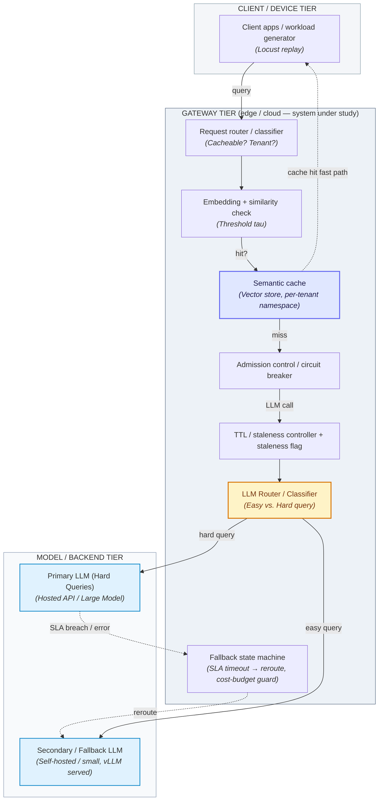

# CacheGate: A Semantic-Caching and Fallback API Gateway for LLM

An LLM API gateway that cuts inference cost via semantic caching and preserves availability via model fallback, evaluated under adversarial and burst workloads.
---

## 1. Problem Statement and Motivation

Applications that call hosted large language model (LLM) APIs—chat assistants, RAG search, coding copilots—pay per token on every request, even when a large fraction of incoming queries are near-duplicates of earlier ones (rephrased FAQs, repeated support questions, common code completions). Teams operating these applications face two compounding problems:

1. **Linear Spend vs. Redundant Traffic:** API spend grows linearly with traffic even though query redundancy does not.
2. **Single Point of Failure:** A single upstream model provider creates a single point of failure. Rate limits, latency spikes, or outages on the primary model degrade or break the application for every user simultaneously.

Individually rate-limiting, retrying, or caching at the application layer is ad hoc and duplicated across every service that calls an LLM. The technical gap is a shared, transparent gateway tier that intercepts LLM traffic, serves semantically equivalent queries from a cache instead of re-invoking the model, and falls back to a secondary model when the primary is slow, over budget, or unavailable—without the calling application being aware of either mechanism.

This problem is inherently a cloud/edge infrastructure problem, not a single-machine one: the gateway must sit in the network path between many concurrent clients and one or more remote model backends, maintain a shared low-latency vector index that many requests hit concurrently, enforce cross-tenant isolation on cached data, and make sub-second routing decisions under bursty, adversarial, and partially-failing conditions—none of which a single process serving one client can exhibit or be evaluated against.

---

## 2. Scope: In-Scope, Out-of-Scope

### In-Scope
* A gateway service that classifies, embeds, and semantically matches incoming LLM queries against a vector-indexed cache of prior (query, response) pairs.
* A fallback state machine that reroutes to a secondary (smaller / self-hosted) LLM on primary-model timeout, error, or cost-budget breach.
* Per-tenant cache namespacing, TTL-based staleness handling, and an admission-control / circuit-breaker layer under overload.

### Out-of-Scope
* Training or fine-tuning any LLM; the primary and fallback models are used as-is (hosted API + a served open-weight model).
* A production-grade billing/subscription system for gateway tenants; tenants are simulated identities, not paying customers.
* General-purpose API gateway features unrelated to LLM traffic (e.g., REST API versioning, GraphQL support).
* A polished end-user chat UI; the client tier is a workload generator and a minimal demo console.


---

## 3. Stakeholders and Usage Scenarios

### Roles
* **End-user application:** The calling service/app that sends LLM queries through the gateway, unaware of caching/fallback internals.

* **Adversary:** An external or malicious-tenant actor attempting to poison the cache, exfiltrate another tenant's cached data, or inflate API spend.

### Usage Scenarios
* **(S1) Cache Acceleration:** A support chatbot receives 200 similar "How do I reset my password" variants during a product outage; the gateway serves most from cache within milliseconds instead of 200 separate LLM calls.
* **(S2) Transparent Rerouting:** The primary hosted model returns HTTP 429 during a traffic spike; the gateway detects the SLA breach and transparently reroutes in-flight and new queries to the fallback model until the primary recovers.
* **(S3) Adversarial Defense:** An adversarial tenant submits a stream of near-duplicate paraphrases specifically crafted to miss the cache (denial-of-wallet) while a second adversary attempts to read another tenant's cached response by submitting a semantically close query across the tenant boundary; the gateway must resist both.

---

## 4. Functional Requirements

* **FR-1 (Must):** The gateway shall return a cached response for any query whose embedding similarity to a prior stored query exceeds a configurable threshold $\tau$, without invoking the primary or fallback LLM.
  * *Acceptance:* A replayed exact-duplicate query is served with no upstream LLM call recorded in the trace log.
* **FR-2 (Must):** The gateway shall reroute a request to the fallback LLM when the primary LLM's response time exceeds a configured SLA or returns an error, without the client receiving an error.
  * *Acceptance:* Under an injected primary-model failure (mocked 5xx/timeout), 100% of subsequent requests within the detection window are served by the fallback model and the client receives a 200-level response.
* **FR-3 (Should):** The gateway shall attach a staleness flag to any cached response older than a configurable TTL.
  * *Acceptance:* A cached entry queried after its TTL elapses is returned with `staleness=true` in the response metadata.
* **FR-4 (Must):** The gateway shall isolate cached entries by tenant namespace such that a query from tenant A cannot retrieve a cache entry written by tenant B.
  * *Acceptance:* A cross-tenant replay of a semantically identical query returns a fresh LLM call, not tenant B's cached response, verified for $\ge 100$ adversarial cross-tenant query pairs.
* **FR-5 (Should):** The gateway shall expose an admission-control layer that rejects or queues requests once a configured concurrency or cost-rate limit is reached.
  * *Acceptance:* Under a load test exceeding the configured limit, excess requests receive a defined 429/queued response rather than silently degrading all tenants.
* **FR-6 (Could):** The gateway shall detect and block queries identified as cache-poisoning or denial-of-wallet attempts based on a rule/anomaly policy.
  * *Acceptance:* A scripted poisoning attempt from the red-team harness is flagged and blocked to meet the target detection rate stated in NFR-7.


---

## 5. Non-Functional Requirements

* **NFR-1 (Cache Latency):** $p99$ cache-hit latency $\le 50\text{ ms}$ at 200 QPS, sustained over a 10-minute steady-state run, measured client-side with Locust against the gateway's cache-hit path only.
* **NFR-2 (Fallback Activation):** Fallback activation latency (failure detection + reroute) $\le 300\text{ ms}$ at the point of injected primary-model failure, measured over 50 induced-failure trials.
* **NFR-3 (Cost Efficiency):** Cost per 1,000 queries is at most 40% of the no-cache baseline cost, under a replay workload with 60% semantic redundancy, computed from the cost model in Sec. 7.
* **NFR-4 (Isolation Security):** Cross-tenant cache isolation: 0 confirmed cross-tenant leakages out of $\ge 500$ adversarial cross-tenant probe queries (supports FR-4).
* **NFR-5 (Burst Resilience):** System sustains $\ge 50\times$ burst-over-baseline traffic (deadline-spike-style load) for a 10-minute window with $p99$ end-to-end latency $\le 1.5\text{ s}$, measured with Locust driven from $\ge 2$ client VMs.
* **NFR-6 (Poisoning Defense):** Cache-poisoning red-team suite: post-mitigation, $\le 5\%$ of adversarial poisoning attempts succeed in serving a manipulated response to a victim query, versus a measured pre-mitigation baseline.


---

## 6. System Architecture and Technology Stack

### Component and Data-Flow Overview
The system spans three tiers—**client/device**, **gateway (edge or cloud)**, and **model/backend**:

* **Data Flows:**
  1. **Queries:** Flow from Client Tier $\rightarrow$ Gateway Tier.
  2. **Upstream Traffic:** Only cache-miss queries and their responses cross Gateway $\rightarrow$ Model Tier.
  3. **Adversarial Queries:** Enter at the client boundary indistinguishably from organic traffic.



### Technology Stack
* **Gateway Service:** FastAPI (Python) behind an ALB / API Gateway, containerized on ECS or EKS. Chosen over a raw Lambda-only design because the semantic-cache lookup benefits from a warm, long-lived embedding-model process rather than per-invocation cold starts.
* **Embedding + Vector Store:** Lightweight sentence-embedding model (self-hosted) with `pgvector` (Postgres) or FAISS-backed index. Chosen over a managed vector DB (e.g., Pinecone) to stay within student-tier budget while supporting per-tenant namespacing.
* **Primary Model:** Hosted LLM API (e.g., OpenAI, Anthropic).
* **Fallback Model:** Small open-weight model ($\le 8\text{B}$) served via vLLM with continuous batching, hosted on a GPU/CPU instance sized to free-tier limits.
* **Observability:** Prometheus + Grafana + OpenTelemetry Collector (reusing course lab infrastructure) for per-request tracing of hit/miss, latency, and routing.
* **Load/Attack Generation:** Locust for workload generation; custom Python red-team harness scripting poisoning, leakage, and denial-of-wallet probes.

### Key Design Decisions

| Decision | Alternative Rejected | Reason |
| :--- | :--- | :--- |
| **Self-hosted embedding + `pgvector` for cache index** | Managed vector DB (Pinecone / Weaviate Cloud) | Avoids recurring managed-service cost against a fixed student credit budget; `pgvector` is sufficient at the evaluated scale ($\le 10,000$ cached entries) and keeps per-tenant namespace isolation under direct control for red-team experiments. |
| **Synchronous in-path fallback state machine** | Async queue + eventual reroute | Fallback must complete within the client's request lifetime (NFR-2); an async design trades away the latency guarantee this project evaluates. |
| **ECS/EKS-hosted gateway (warm process)** | Pure Lambda-per-request gateway | The embedding model and vector index need a warm, resident process to hit the NFR-1 latency target ($p99 \le 50\text{ ms}$); Lambda cold starts would dominate the cache-hit path. |

---

## 7. Evaluation Plan

### Workload Generator
A Locust-driven replay of a query trace built from a public conversational/FAQ dataset, parameterized by:
1. **Semantic Redundancy %:** Exact duplicate, paraphrase, related-but-distinct, novel.
2. **Burst Shape:** Steady-state vs. $50\text{--}100\times$ deadline-spike burst.
3. **Adversarial Fraction Knob:** Injects red-team probe queries at a controlled rate alongside organic traffic.

### Configurations Compared
* **C0 (Baseline):** Direct passthrough to the primary LLM, no cache, no fallback.
* **C1:** Semantic cache only (no fallback).
* **C2 (Full System):** Semantic cache + fallback + admission control.
* **C3 (Stretch):** C2 under GPU-quantized fallback model, to add a cost/quality data point.

### Metrics
* **Cache Hit Rate & Latency ($p50/p99$):** Validates FR-1, NFR-1.
* **Fallback Trigger Accuracy & Activation Latency:** Validates FR-2, NFR-2 under injected failures.
* **Cost per 1,000 Queries:** C0 vs. C1 vs. C2 as a function of redundancy % (validates NFR-3).
* **Cross-Tenant Leakage Count:** Under adversarial probing (validates FR-4, NFR-4).
* **Burst Latency ($p99$):** Under $50\text{--}100\times$ burst (validates NFR-5).
* **Red-Team Success Rate:** Pre- vs. post-mitigation for poisoning and denial-of-wallet (validates FR-6, NFR-6, NFR-7).

### Cost Model
$$\text{Cost per 1,000 queries} = \left( N_{\text{miss}} \times \$_{\text{primary}} \right) + \left( N_{\text{fallback}} \times \$_{\text{fallback}} \right) + \$_{\text{gateway\_amortized}} + \$_{\text{vector\_store\_amortized}}$$

Reported as a function of measured hit rate to provide a reproducible trade-off curve for any traffic mix.

### Expected Result Plots
1. **Cost-per-1,000-queries** ($y$) vs. **Semantic Redundancy %** ($x$), for configurations C0–C2.
2. **$p50/p99$ Latency** ($y$) vs. **QPS** ($x$), per configuration, with the burst window highlighted.
3. **Red-team success rate** ($y$) pre- vs. post-mitigation (grouped bar), per attack type.
4. **Fallback activation latency distribution (CDF)** across induced-failure trials.

---

## 8. Work Plan, Milestones and Risks

### 6-Week Work Plan (Parallel Tracks)

```
        W0          W1          W2          W3          W4          W5          W6
Track A  |===========[M1: Router/Cache]======[M2: Fallback/Admission]===========|
Track B  |---[Threat Model]---[Build Attacks (Poison/DoW/Leak)]---[Mitigations]-|
Track C  |---[Locust Generator]---[Baseline/Config Exps]---[Cost Model/Plots]---|

```

| Task | Owner | Week(s) |
| :--- | :--- | :--- |
| **Router, classifier, embedding + vector cache** | Member A | 1–2 |
| **Fallback state machine + admission control** | Member A | 3–4 |
| **Threat modelling + attack scripting (poisoning, leakage, DoW)** | Member B | 1–4 |
| **Mitigations + red-team re-test** | Member D | 5 |
| **Locust workload generator + baseline/config experiments** | Member C | 1–5 |
| **Cost model + result plots** | Member C | 5–6 |


### Key Milestones
* **M1 (End of Week 2):** Core gateway (router + cache) live, hit-rate demo; initial threat model reviewed.
* **M2 (End of Week 4):** Fallback + admission control integrated; first live attack/defense demo (one attack blocked).
* **M3 (End of Week 6):** Full evaluation matrix run, cost model validated, dashboard-driven demo ready for industry panel.

### Risks and Mitigations
* **R1: Hosted-LLM API cost overrun during experiments**
  * *Mitigation:* Rate-limit primary-model calls in development, run full-scale experiments only during scheduled windows, and use the self-hosted fallback model as primary during rehearsal.
* **R2: Self-hosted fallback model GPU quota insufficient**
  * *Mitigation:* Pre-select a quantized $\le 3\text{B}$ variant validated against student-tier GPU limits in Week 1, with a CPU-only fallback contingency plan.
* **R3: Red-team track under-resourced if core build slips**
  * *Mitigation:* Keep Track B fully decoupled (targeting the gateway's public interface rather than internals) and start it in Week 1 in parallel.

### Minimum Viable Product (MVP) vs. Stretch Goals
* **MVP:** Configurations C0 and C2, FR-1/FR-2/FR-4 implemented and tested, NFR-1/NFR-2/NFR-3 validated, and cache-poisoning red-team test (FR-6/NFR-6) demonstrated end-to-end.
* **Stretch Goals:** Configuration C3 (quantized-model comparison), full denial-of-wallet mitigation (NFR-7), and the live public-facing dashboard (FR-8).

---

## 9. References

1. **LiteLLM / Portkey / Helicone:** Production LLM gateway projects informing fallback and observability design (Apache-2.0 / MIT licenses).
2. **vLLM Project:** Continuous batching and served-model deployment for the fallback tier (Apache-2.0).
3. **pgvector Documentation:** Vector similarity search in PostgreSQL for the semantic cache index (PostgreSQL license).
4. **DS252 Course Materials:** Weeks 1, 4, 5, 8, 9, 10—IaaS, serverless, Kubernetes, and observability lab content reused for gateway and telemetry.
5. **LLM Usage Statement:** Claude (Anthropic) was used to iterate on requirement wording, stress-test scope boundaries, and review the evaluation design for missing baselines, per course guidance.


